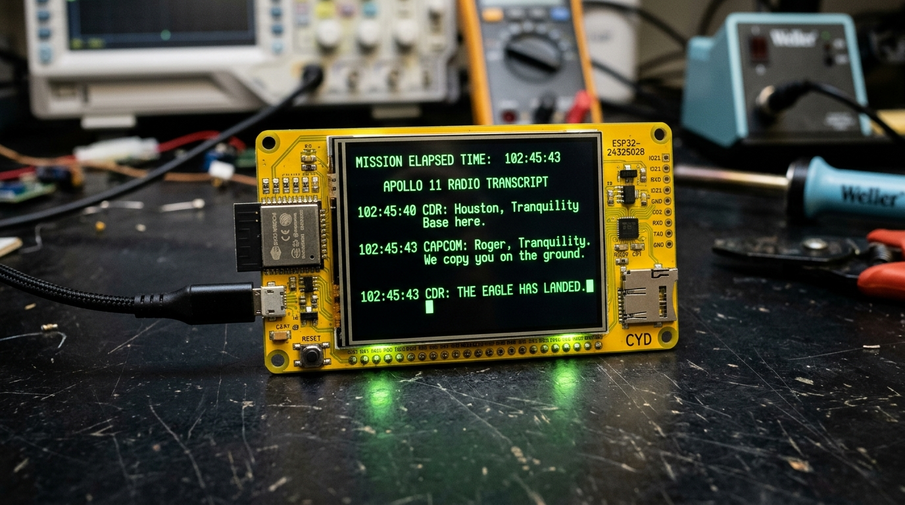
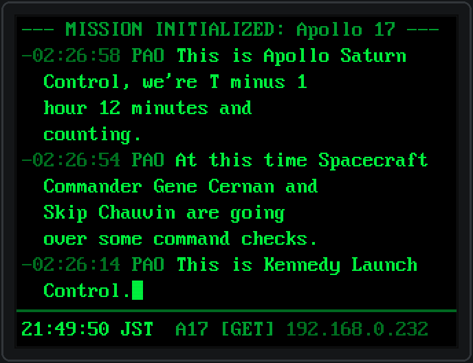
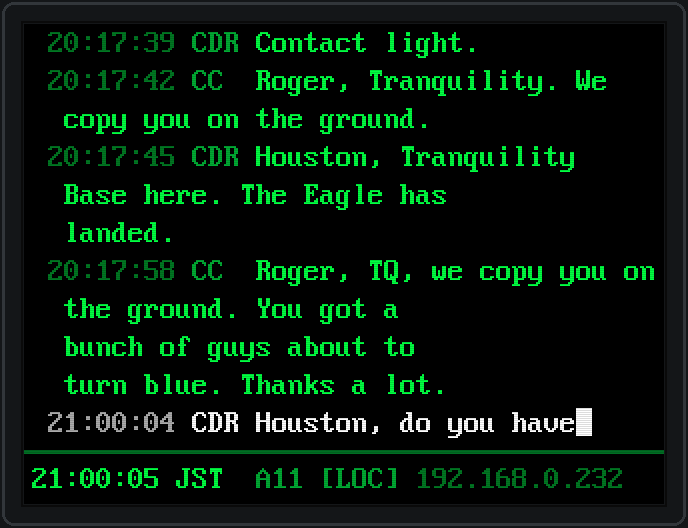
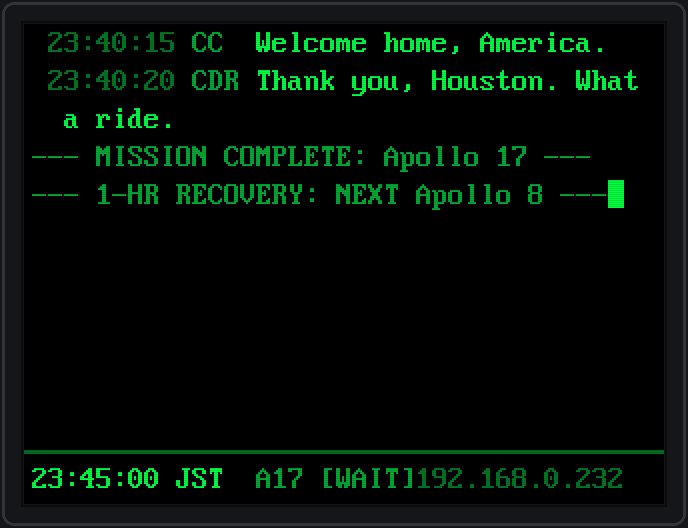

# ESP32 CYD NASA Apollo Mission Clock (`esp_missionclock`)

> 📖 **[日本語のドキュメントはページ後半にあります / Japanese documentation is available below](#japanese-doc)**

Recreating historical NASA Apollo radio transcripts utterance-by-utterance in authentic historical cadence, styled as a 1960s–1970s Apollo Mission Control phosphor CRT terminal on the ESP32 Cheap Yellow Display (ESP32-2432S028, 320×240).

<p align="center">
  
</p>

---

## 📸 Screenshots

| Apollo 17 Countdown & Hold (`[GET]` Historical Mode) | Apollo 11 Lunar Landing & Hourly Easter Egg (`[LOC]` Local Mode) |
| :---: | :---: |
|  |  |

| Mission Complete & 1-Hour Recovery Intermission (`WAIT` Mode) |
| :---: |
|  |

---

## ✨ Features

1. **Strict Real-Time Historical Timing Cadence**
   - No artificial fast-forwarding or silence compression. Radio silences across deep space (whether 30 seconds or 45 minutes) are held in authentic silence, preserving the true tension of countdown holds and lunar descents.
   - Fixed time offset (`s_base_local_sec = current_time - first_event_get_sec`) calibrated at boot via SNTP.

2. **1960s–1970s Glass CRT Terminal Aesthetic**
   - **Deep Pure Black Background** (`#000000`) paired with high-phosphor bright green (`#00ff41`) and glow dim green (`#00aa33` / `#007722`).
   - True 1bpp 8×16 monospace font extracted from the Linux kernel VGA font (crisp 1px stroke, zero blur).
   - **12-Line Terminal Grid**: 11 scrolling radio transcript rows + horizontal divider line + bottom status bar.
   - Multi-line utterances and consecutive same-speaker transmissions cleanly omit redundant timestamps/speaker tags and wrap with a 2-space continuation indent (`  `).

3. **Typewriter Animation & 1-Second Clock Pulse Block Cursor**
   - Transcripts are typed out character-by-character with natural human keypress latency and punctuation hesitation.
   - A solid rectangular block cursor (`█` / `0x7F`) blinks at a **1-second period (1s ON / 1s OFF)**, perfectly synchronized with the digital clock second hand.

4. **Split-Screen Touch Controls**
   - **Upper Half Tap (`Y < 120`)**: Cycles backlight brightness through **0% (Off) → 20% (Night/Dim) → 100% (Full) → 0%** (persisted in NVS). When the display is off (0%), tapping anywhere wakes it back up to 20%.
   - **Lower Half Tap (`Y >= 120`)**: Instantly toggles timestamp display mode:
     - **`[LOC]` (Local Time Mode)**: Current wall clock time offset from mission start (e.g., ` 21:49:50 CDR ...`)
     - **`[GET]` (Historical GET Mode)**: Ground Elapsed Time relative to liftoff (e.g., `-02:26:14 PAO ...` / `+00:01:23 CDR ...`)
   - Uniform 9-character timestamp width with restored colons ensures speaker tags and messages never shift horizontally when toggling.

5. **4 Complete Apollo Missions with 1-Hour Recovery Intermission Cycle**
   - **Apollo 17 (The Main Star)**: Night launch, the famous T-30s sequencer hold and ~1h14m delay, manual tank pressurization, through to the final lunar EVA closing words.
   - **Apollo 11**: Lunar descent, 1202 alarms, Tranquility Base landing (*"The Eagle has landed"*), and first steps (*"That's one small step for man..."*).
   - **Apollo 13**: Launch, oxygen tank explosion crisis (*"Houston, we've had a problem"*), Aquarius lifeboat operations, and splashdown.
   - **Apollo 8**: First crewed voyage to lunar orbit, Christmas Eve Genesis reading (*"In the beginning..."*), and safe return.
   - **1-Hour Intermission**: When a mission finishes, a completion banner is posted, followed by a **1-hour quiet recovery wait** before automatically cycling to the next chronological mission (8 → 11 → 13 → 17 → 8...). Jokes are completely suppressed during this intermission.

6. **Hourly Joke & Surreal Banter Easter Egg (:00 to :01)**
   - Every hour on the hour, if no historical event is scheduled, a crew member calls Houston to ask for the current time down on Earth (*"It's four o'clock"*).
   - Random surreal banter (ordering Cocoa Beach pizza to orbit, Siri on the AGC, seeing a blue police telephone box, asking for the CM WiFi password, or Moon weather forecast).
   - Rendered in **Crisp White (`#ffffff`)** to clearly distinguish it from authentic historical transmissions.

7. **Captive Portal Web Configuration**
   - On initial boot or network change, connects via SoftAP `CYD-MissionClock-Setup` (or via acquired local IP address) to configure Wi-Fi credentials, active mission, backlight brightness, and timezone.

---

## 🛠 Hardware Specifications & Pinout

Target Board: **ESP32 Cheap Yellow Display (CYD / ESP32-2432S028, 2.8" 320×240 TFT LCD + XPT2046 Touch)**

| Component | Signal | ESP32 GPIO | Description |
| :--- | :--- | :--- | :--- |
| **LCD Display (SPI2)** | SCK | GPIO 14 | 40MHz SPI |
| | MOSI | GPIO 13 | Data |
| | MISO | GPIO 12 | |
| | DC | GPIO 2 | Command / Data |
| | CS | GPIO 15 | Chip Select |
| | Backlight | GPIO 21 | PWM Brightness Control |
| **Touchscreen (SPI3)** | CLK | GPIO 25 | XPT2046 Controller |
| | MOSI | GPIO 32 | |
| | MISO | GPIO 39 | |
| | CS | GPIO 33 | Chip Select |
| | IRQ | GPIO 36 | Interrupt Input |
| **Onboard RGB LED** | RED / GREEN / BLUE | GPIO 4 / 16 / 17 | Active LOW |

---

## 🚀 Build & Flash Instructions

Built and verified with **ESP-IDF v5.3**.

```bash
# 1. Source ESP-IDF environment
source /path/to/esp-idf/export.sh

# 2. Clone repository and build
git clone https://github.com/<your-username>/esp_missionclock.git
cd esp_missionclock
idf.py build

# 3. Flash to ESP32 CYD and open serial monitor
idf.py -p /dev/ttyUSB0 flash monitor
```

---

## ⚙️ Initial Setup & Web Portal

1. On boot without saved Wi-Fi credentials, the device launches SoftAP **`CYD-MissionClock-Setup`**.
2. Connect to this Wi-Fi network and open `http://192.168.4.1` in your browser.
3. Enter your Wi-Fi SSID, password, initial mission, and timezone, then click **SAVE & APPLY**.
4. Once connected, the clock syncs time via SNTP, and the acquired IP address (e.g. `192.168.0.232`) is displayed on the bottom status bar. Access this IP anytime from your browser to change settings.

---

## 📁 Repository Structure

```text
esp_missionclock/
├── CMakeLists.txt              # Project root CMake
├── sdkconfig.defaults          # Flash 4MB, -O3 compiler optimization
├── partitions.csv              # 4MB Flash partition table
├── main/
│   ├── main.c                  # Application entry point
│   ├── config.h                # Pinout, color palette, grid definitions
│   ├── term_font_8x16.c/.h     # Linux VGA 8x16 1bpp font with block cursor
│   ├── terminal_ui.c/.h        # 12-line retro CRT terminal UI & typewriter animation
│   ├── mission_engine.c/.h     # Historical timeline engine & 1-hr intermission
│   ├── mission_data.c/.h       # On-demand zlib chunk decompression (MISZ format)
│   ├── settings_mgr.c/.h       # NVS persistent configuration manager
│   ├── display_driver.c/.h     # ST7789 / ILI9341 LCD driver
│   ├── touch_driver.c/.h       # XPT2046 resistive touch driver
│   ├── wifi_portal.c/.h        # SoftAP & Web configuration portal
│   ├── sntp_time.c/.h          # SNTP network time synchronization
│   └── data/                   # Compiled mission timeline binaries (.bin)
├── tools/
│   ├── fetch_and_pack_missions.py # Transcript scraper, cleaner, word-wrapper & packer
│   ├── generate_font_8x16.py      # Linux kernel font extractor & C source generator
│   └── render_screenshot.py       # Bit-perfect CRT screenshot renderer using real font
└── docs/
    └── images/                 # High-resolution screenshots and hardware showcase
```

---

## 📜 Acknowledgements & Data Sources

- **NASA Apollo Mission Transcripts**:
  - [Spacelog](https://github.com/Spacelog/Spacelog) (Apollo 8, Apollo 11, Apollo 13)
  - [Ben Feist's Apollo 17 in Real-Time](https://apolloinrealtime.org/17/) (Apollo 17 Master TEC & PAO transcripts)
- **Reference Project**:
  - `esp_consoleclock` (Wi-Fi portal, display driver, and SNTP architecture)

---

## 📄 License

MIT License.

---

<br><br>

---

<a id="japanese-doc"></a>
# 🚀 ESP32 CYD NASA アポロ・ミッションクロック (日本語ドキュメント)

**1960〜70年代のNASA管制室CRT端末スタイルで、アポロ計画の史実無線交信ログをリアルタイムの時間間隔で追体験するESP32 CYD（Cheap Yellow Display / ESP32-2432S028）向け時計アプリケーション。**

---

## 📸 スクリーンショット

| Apollo 17 カウントダウン＆保留 (`[GET]` 史実モード) | Apollo 11 月面着陸＆正時イースターエッグ (`[LOC]` 実時刻モード) |
| :---: | :---: |
|  |  |

| ミッション完了と1時間インターミッション (`WAIT` 待機モード) |
| :---: |
|  |

---

## ✨ 主な特徴

1. **史実の時間間隔を厳格に再現（完全リアルタイム追体験）**
   - 人工的な早送りやスキップを行わず、宇宙空間の数分〜数十分の沈黙もそのまま待機。打ち上げカウントダウン保留や月面着陸時の張り詰めた沈黙と緊張感をリアルタイムに追体験できます。
   - 起動時の実時刻（SNTP同期）とミッション先頭イベントのGETオフセットを固定保持して進行します。

2. **1960〜70年代のGlass CRT（陰極線管）ターミナル美学**
   - **完全漆黒背景**（`#000000`）に、高輝度リン光グリーン（`#00ff41`）とディムグリーン（`#00aa33` / `#007722`）のCRTデュアルカラー構成。
   - Linuxカーネル由来のTrue 1bpp 8×16 ドットモノスペースフォント（1pxストローク、にじみゼロ）。
   - **12行構成レイアウト**: スクロールする無線交信ログ 11行 ＋ 水平区切り線 ＋ 最下部ステータスバー 1行。
   - 複数行にわたる長い発言や同一話者の連続発言時は、冗長なタイムスタンプと発言者タグを省略し、2文字インデント（`  `）で折り返し描画。

3. **タイプライター演出 & 1秒点滅ブロックカーソル**
   - 新たな発言は、通信士や管制官がキーボードを叩いているかのような人間らしい揺らぎ（タイピング遅延・句読点での一息）を伴って1文字ずつタイピング表示。
   - 時計の秒針（1秒）と美しく同期した **1秒周期（1s点灯 / 1s消灯）の塗りつぶし長方形ブロックカーソル（`█`）**。沈黙期間中も静かに呼吸するように点滅待機します。

4. **画面上下分割タップ操作（輝度調整 ＆ 時刻モード切替）**
   - **画面上半分タップ (`Y < 120`)**: バックライト輝度を **0%（消灯） → 20%（夜間/薄暗） → 100%（全開） → 0%** の順序で瞬時にトグル巡回（NVSに自動保存）。消灯時（0%）は画面のどこをタップしても即座に20%に復帰します。
   - **画面下半分タップ (`Y >= 120`)**: タイムスタンプ表示モードを瞬時に切り替え：
     - **`[LOC]`（実時刻モード）**: 起動時を起点にオフセットされた現在の時計時刻（例: ` 21:49:50 CDR ...`）
     - **`[GET]`（史実モード）**: 打ち上げを基準とするGround Elapsed Time（例: `-02:26:14 PAO ...` / `+00:01:23 CDR ...`）
   - コロン付き9文字幅統一表記により、モードを切り替えても話者名や本文の横位置が一切左右にブレない設計。

5. **全4ミッション完全収録 & 完了時の1時間インターミッション自動巡回**
   - **アポロ17号 (主役)**: T-30秒での自動停止と約1時間14分のカウントダウン保留、推進薬タンク加圧、そして夜間打ち上げの咆哮から月面最後のEVAまで。
   - **アポロ11号**: 月面降下、1202警報、静かの海への着陸（*"The Eagle has landed."*）、人類最初の一歩。
   - **アポロ13号**: 打ち上げ、酸素タンク爆発事故（*"Houston, we've had a problem."*）、月着陸船での生還。
   - **アポロ8号**: 人類初の月周回軌道進入、クリスマスイブの創世記朗読、無事の帰還。
   - **1時間インターミッション**: ひとつのミッションが完了すると完了バナーを掲示し、1時間のリカバリー待機を挟んで次のアポロミッション（8 → 11 → 13 → 17 → 8...）へと自動で巡回。待機中はジョークを抑制して静かに時を待ちます。

6. **毎正時のジョーク＆シュール会話イースターエッグ (:00〜:01)**
   - 毎時00分〜01分の間に史実無線交信がない場合に限り、宇宙飛行士がヒューストンに現在時刻を尋ね、CAPCOMが現在時刻をアナウンス（*"It's four o'clock"* 等）。
   - ココアビーチのピザ出前を頼もうとしたり、AGCのDSKYでSiriを呼んでしまったりするシュールなやり取りがランダムで発生。
   - **白色文字（`#ffffff`）** で表示され、史実の無線記録と明確に区別されます。

7. **Web設定ポータル (Wi-Fi Captive Portal)**
   - 初回起動時または設定時は SoftAP `CYD-MissionClock-Setup` に接続、またはブラウザで取得IPアドレスにアクセスするだけで、Wi-Fi設定、ミッション選択、画面輝度、タイムゾーン設定が可能。

---

## 🛠 ハードウェア仕様とピンアサイン

対象デバイス: **ESP32 Cheap Yellow Display (CYD / ESP32-2432S028, 2.8インチ 320×240 TFT LCD + XPT2046 タッチ)**

| 機能 | 信号名 | ESP32 GPIO | 備考 |
| :--- | :--- | :--- | :--- |
| **LCD ディスプレイ (SPI2)** | SCK | GPIO 14 | 40MHz SPI |
| | MOSI | GPIO 13 | |
| | MISO | GPIO 12 | |
| | DC | GPIO 2 | コマンド/データ選択 |
| | CS | GPIO 15 | チップセレクト |
| | Backlight | GPIO 21 | PWM 調光対応 |
| **タッチスクリーン (SPI3)** | CLK | GPIO 25 | XPT2046 |
| | MOSI | GPIO 32 | |
| | MISO | GPIO 39 | |
| | CS | GPIO 33 | |
| | IRQ | GPIO 36 | 割込み検知 |
| **オンボード RGB LED** | RED / GREEN / BLUE | GPIO 4 / 16 / 17 | Active LOW |

---

## 🚀 ビルドと書き込み (Build & Flash)

本プロジェクトは **ESP-IDF v5.3** にて開発・検証されています。

```bash
# 1. ESP-IDF 環境変数の読み込み
source /path/to/esp-idf/export.sh

# 2. リポジトリのクローンとビルド
git clone https://github.com/<your-username>/esp_missionclock.git
cd esp_missionclock
idf.py build

# 3. デバイスへの書き込み & シリアルモニタ起動
idf.py -p /dev/ttyUSB0 flash monitor
```

---

## ⚙️ 初回設定とWebポータル

1. デバイスが未接続のWi-Fi環境で起動すると、自動的に SoftAP **`CYD-MissionClock-Setup`** が起動します。
2. スマートフォンやPCからこのWi-Fiに接続し、ブラウザで `http://192.168.4.1` にアクセスします。
3. 自宅のWi-Fi SSID、パスワード、初期ミッション、タイムゾーン等を入力して「SAVE & APPLY」を押下します。
4. Wi-Fi接続後はSNTPにより正確なJST時刻を取得し、最下部ステータスバーに取得したローカルIPアドレス（例: `192.168.0.232`）が表示されます。以降はそのIPアドレスにブラウザからアクセスすることでいつでも設定変更が可能です。

---

## 📁 ディレクトリ構成

```text
esp_missionclock/
├── CMakeLists.txt              # プロジェクトトップ CMake
├── sdkconfig.defaults          # Flash 4MB, O3最適化設定
├── partitions.csv              # 4MB Flash パーティション構成
├── main/
│   ├── main.c                  # アプリケーションエントリポイント
│   ├── config.h                # ピンアサイン、色定義、グリッド定数
│   ├── term_font_8x16.c/.h     # Linux VGA 8x16 1bpp フォント (ブロックカーソル含む)
│   ├── terminal_ui.c/.h        # 12行レトロCRTターミナルUI & タイプライター演出
│   ├── mission_engine.c/.h     # 史実タイムライン進行 & 1hインターミッション
│   ├── mission_data.c/.h       # ROM minizによるMISZ圧縮データのオンデマンド展開
│   ├── settings_mgr.c/.h       # NVS設定管理
│   ├── display_driver.c/.h     # ST7789 / ILI9341 LCDドライバ
│   ├── touch_driver.c/.h       # XPT2046 タッチドライバ
│   ├── wifi_portal.c/.h        # SoftAP & Web設定ポータル
│   ├── sntp_time.c/.h          # SNTP時刻同期
│   └── data/                   # 生成されたミッションバイナリ (.bin)
├── tools/
│   ├── fetch_and_pack_missions.py # 史実トランスクリプトの取得・クリーン分割・圧縮
│   ├── generate_font_8x16.py      # Linuxカーネルフォント抽出・Cソース生成
│   └── render_screenshot.py       # 実フォントビットマップを用いたPNG画像レンダラ
└── docs/
    └── images/                 # スクリーンショット・実機写真
```

---

## 📜 謝辞・クレジット (Acknowledgements)

- **NASA Apollo Mission Transcripts**:
  - [Spacelog](https://github.com/Spacelog/Spacelog) (Apollo 8, Apollo 11, Apollo 13)
  - [Ben Feist's Apollo 17 in Real-Time](https://apolloinrealtime.org/17/) (Apollo 17 Master TEC & PAO transcripts)
- **Reference Project**:
  - `esp_consoleclock` (Wi-Fiポータル、ディスプレイドライバ、SNTP基盤設計)

---

## 📄 ライセンス

MIT License.
